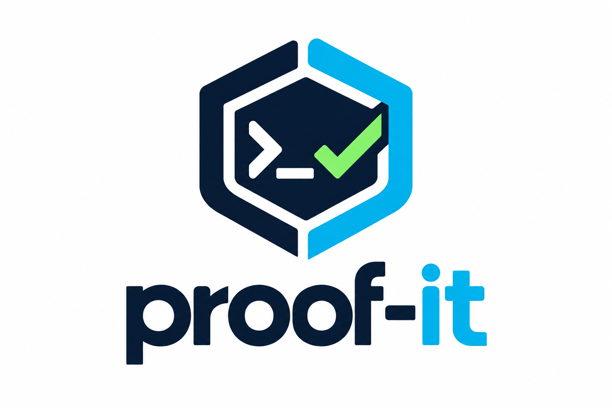

<p align="center">
  <picture>
    <source media="(prefers-color-scheme: dark)" srcset="docs/assets/proof-it-logo-dark.png">
    
  </picture>
</p>

# Proof-It

> **Status: alpha (v0.1.0-alpha.1).** Useful today as a security scanner with honest
> results. Not yet a reliable gate for production code: read
> [the limits](#what-it-cannot-do-yet) before you trust it.

## The problem

More and more code is written by AI agents and merged after a quick review. The
usual safety net is a green CI run: the tests pass and the scanner found nothing.
Neither says the code is safe.

- **Tests show the cases someone thought of.** An endpoint that returns another
  user's data passes every test that never tries it.
- **"No findings" from a scanner means nothing was matched**, not that nothing is
  wrong. Code the tool could not parse, middleware it could not see, and rules
  it does not have all come out the same as "clean".
- **AI agents optimise for the checks they can see.** If a guard is credited
  because it is *called* `requireAdmin`, an agent (or a hurried human) can
  satisfy the check without enforcing anything.

The question a reviewer actually needs answered is: *what do we know about
this change, how do we know it, and what don't we know?*

## What Proof-It does about it

Proof-It is a command-line tool for TypeScript, JavaScript and Go services
(Go: security analysis; formal properties are TypeScript/JavaScript for now)
that answers that question with evidence and refuses to blur the categories:

| Result | Means |
|---|---|
| **PROVEN** | A precisely stated property (e.g. "a user can only read records they own") holds for the model extracted from the code, the Lean 4 kernel checked the proof, the theorem is not vacuous, and it does **not** follow from Proof-It's own assumptions alone |
| **VIOLATED** | A concrete counterexample exists in the model, certified by Lean, and it holds whatever the code Proof-It could not interpret does |
| **UNPROVEN** | Neither: the result depends on something Proof-It cannot see or interpret, and it says what |
| **INCOMPLETE** (run verdict) | Some source code was not analysed, so the run cannot pass |

It never says "bug-free", and a missing analysis is never reported as a pass.

```text
✗ AUTHZ-002  DELETE /admin/users/:id   VIOLATED
    Middleware `requireAdmin` never denies a request (its code always continues): it enforces nothing.
⚠ AUTHZ-001  GET /shared/:id           UNPROVEN
    A violation exists only if an unanalysed condition holds (sharingService.canView(...)).
✓ AUTHZ-001  GET /records/:id          PROVEN
```

For changes made by AI agents, `proof-it check` reports which properties a
change affects, what regressed, whether the verification policy itself was
weakened, and a merge decision (`AUTO-MERGE ELIGIBLE` / `HUMAN REVIEW
REQUIRED` / `BLOCKED`) in a machine-readable protocol the agent can act on.

## What it cannot do yet

Be clear-eyed about these before relying on it:

- **Recall is limited.** On deliberately vulnerable applications it was not
  tuned on, it found **39–56%** of the documented, code-visible
  vulnerabilities; measured per file on Juice Shop's challenge variants,
  **30%**. Scores on applications it was tuned on (97%+) are regression tests,
  not evidence. See [docs/validation.md](docs/validation.md).
- **Precision on real code is unmeasured.** It has been spot-checked on one
  production codebase, where it found real issues and also reported design
  choices as violations.
- **Detection is mostly patterns over a syntax tree**, taint tracking stays
  within one module (plus local helpers), and only TypeScript/JavaScript and
  (security-only) Go are supported.
- **The code-to-model translation is not verified.** A PROVEN result is only as
  good as the extractor that built the model; every result lists its
  assumptions.
- It is maintained by a small team and has no production users yet.

If you need breadth today, use it **next to** Semgrep or CodeQL, not instead of them.

## What it does

- **Formal verification** of state machines (terminal states, forbidden
  transitions), object-level authorization (read and write IDOR), admin-only
  operations, and ledger conservation / non-negative balances — Lean 4 proofs,
  Lean-certified counterexamples, non-vacuity witnesses.
- **Security analysis**: taint tracking from request data to SQL/NoSQL, shell,
  eval/vm/templates, filesystem, outbound requests, redirects and HTML; XXE,
  ReDoS, deserialization, prototype pollution, mass assignment, JWT and crypto
  misuse, secrets (redacted), unescaped templates, missing security headers,
  CSRF and rate limiting; plaintext password storage; personal data and
  database dumps committed to the repository; reachable vulnerable
  dependency APIs; Semgrep, gitleaks and osv-scanner adapters.
  `proof-it coverage` maps all of it to OWASP Top 10, OWASP API Top 10 and
  CWE Top 25.
- **Attack engine** (opt-in, sandboxed): replays counterexamples and
  adversarial inputs (NaN, numeric strings, aliasing, junk states) against the
  real implementation to find what the model abstracts away.
- **Assurance for AI-generated changes**: affected properties, regressions,
  detection of verification-policy weakening, protected properties, a merge
  decision (`AUTO-MERGE ELIGIBLE` / `HUMAN REVIEW REQUIRED` / `BLOCKED`),
  change bundles and a structured agent protocol (`proof-it check`).
- **Self-assurance**: Proof-It's own status and merge logic is specified and
  proven in Lean and refinement-tested; model self-check; mutation testing;
  benchmarks; measured recall on vulnerable applications.

Languages:
- **TypeScript and JavaScript** (Express, Koa, Fastify-style routers, NestJS,
  GraphQL resolver maps): security analysis and formal properties.
- **Go** (net/http, gin, echo, fiber, chi, gorilla/mux; database/sql, sqlx, pgx,
  gorm): **security analysis only**, new and not yet measured on a held-out
  application. Authorization proofs for Go are next.
- Source files in other languages are reported as **not analysed**, and the run
  is INCOMPLETE; they are never silently skipped. See the [roadmap](docs/roadmap.md).

## Install

Requirements: Linux or macOS. **Lean 4** via [elan](https://github.com/leanprover/elan)
(without it nothing can be PROVEN). Recommended: `bwrap` (bubblewrap) for
sandboxing, Node.js for `--allow-exec`, and optionally `semgrep`, `gitleaks`,
`osv-scanner`.

```bash
# from a release: download, verify the .sha256, put proof-it on PATH
# from source:
cargo install --path crates/cli
proof-it doctor
```

## Quick start

```bash
cd my-service
proof-it init                    # .proof-it/config.yaml with every option documented
proof-it assure                  # full pipeline
proof-it assure --safe           # untrusted repository: never execute its code
proof-it explain AUTHZ-001       # why a property is proven / violated / unproven
proof-it counterexample PAY-003 --save
proof-it assure --ci --diff origin/main...HEAD --baseline latest   # CI / pull requests
proof-it check --diff main...HEAD --policy /etc/proof-it/policy.yaml --agent my-agent   # agents
```

Exit codes: `0` passed · `1` property/security failure · `2` analysis error ·
`3` configuration error · `4` environment error.

## Documentation

| | |
|---|---|
| [architecture](docs/architecture.md) | Crates, data flow, design rules |
| [formal-verification](docs/formal-verification.md) | What PROVEN means, acceptance rules, limits |
| [evidence-model](docs/evidence-model.md) | Statuses, evidence kinds, run directories, assurance levels |
| [property-system](docs/property-system.md) | Property schema, library, project properties |
| [security-model](docs/security-model.md) | Trusted / analysed / assumed; how Proof-It protects itself |
| [threat-model](docs/threat-model.md) | Threats to analysed apps and to Proof-It |
| [agent-assurance](docs/agent-assurance.md) | Proof-carrying changes for AI agents |
| [cli](docs/cli.md) | Commands, options, configuration, policy |
| [language-adapters](docs/language-adapters.md), [plugin-architecture](docs/plugin-architecture.md) | Extending Proof-It |
| [validation](docs/validation.md) | Benchmarks, recall, precision — including the held-out numbers |
| [roadmap](docs/roadmap.md) | What's next |

## Repository layout

```text
crates/core      types, config, properties, facts IR, sandbox, evidence, decision logic
crates/lang-ts   oxc adapter, guarded walker, detectors
crates/model     model IR, extractors, Lean emitter/runner, formal engine
crates/engine    pipeline, external tools, attack engine, change assurance, reports
crates/cli       the proof-it binary
lean/            Lean 4 project: reference models and Proof-It's own decision logic
properties/      property library      coverage/   OWASP/CWE coverage matrix
benchmarks/      good/bad cases and real-world recall manifest
examples/        demo project, agent demo
```

## Contributing, security, license

- [CONTRIBUTING.md](CONTRIBUTING.md): how to build, test and propose changes.
  New detectors need a vulnerable and a safe benchmark.
- [SECURITY.md](SECURITY.md): report vulnerabilities in Proof-It privately.
- Licensed under the [Apache License 2.0](LICENSE).
